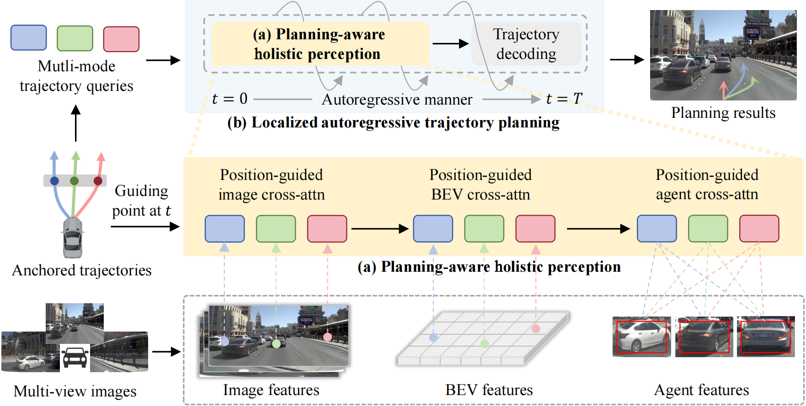

# Perception in Plan: Coupled Perception and Planning for End-to-End Autonomous Driving
### [[Paper]](https://arxiv.org/abs/2508.11488)

> [**Perception in Plan: Coupled Perception and Planning for End-to-End Autonomous Driving**](https://arxiv.org/abs/2508.11488)            
> [Bozhou Zhang](https://zbozhou.github.io/), [Jingyu Li](https://github.com/Whale-ice), [Nan Song](https://scholar.google.com/citations?hl=zh-CN&user=wLZVtjEAAAAJ), [Li Zhang](https://lzrobots.github.io)  
> **arXiv 2025**

## Abstract
End-to-end autonomous driving has achieved remarkable advancements in recent years. Existing methods primarily follow a perception–planning paradigm, where perception and planning are executed sequentially within a fully differentiable framework for planning-oriented optimization. We further advance this paradigm through a "perception-in-plan" framework design, which integrates perception into the planning process. This design facilitates targeted perception guided by evolving planning objectives over time, ultimately enhancing planning performance. Building on this insight, we introduce **VeteranAD**, a coupled perception and planning framework for end-to-end autonomous driving. By incorporating multi-mode anchored trajectories as planning priors, the perception module is specifically designed to gather traffic elements along these trajectories, enabling comprehensive and targeted perception. Planning trajectories are then generated based on both the perception results and the planning priors. To make perception fully serve planning, we adopt an autoregressive strategy that progressively predicts future trajectories while focusing on relevant regions for targeted perception at each step. With this simple yet effective design, VeteranAD fully unleashes the potential of planning-oriented end-to-end methods, leading to more accurate and reliable driving behavior. Extensive experiments on the NAVSIM and Bench2Drive datasets demonstrate that our VeteranAD achieves state-of-the-art performance.

## Pipeline
<div align="center">
  
</div><br/>

## News
- 2025.08, the paper is released on arXiv, and the code will be made publicly available in December 2025.

## BibTeX
```bibtex
@inproceedings{zhang2025veteranad,
 title={Perception in Plan: Coupled Perception and Planning for End-to-End Autonomous Driving},
 author={Zhang, Bozhou and Li, Jingyu and Song, Nan and Zhang, Li},
 booktitle={AAAI},
 year={2026},
}
```
